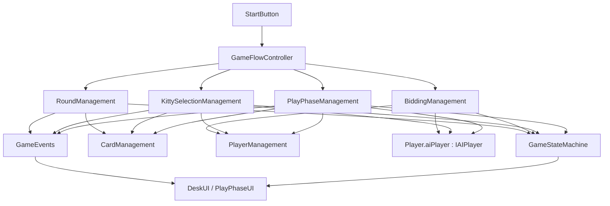

# Poker-DZ 项目结构整理

本文是当前仓库的源码导览，方便从 GitHub 主页进入项目后快速找到入口、数据、规则和 UI。分析基于 `Assets/Scenes/SampleScene.unity` 与 `Assets/Scripts` 中的活跃代码；若要查玩法定义，请看[玩法文档](扑克-叫主.md)；若要看设计思路与复盘，请看[项目学习笔记](项目学习笔记.md)。

## 1. 仓库目录

```text
Poker-DZ/
├─ Assets/
│  ├─ Scenes/SampleScene.unity       主游戏场景
│  ├─ Scripts/
│  │  ├─ Game/                      流程、状态、阶段管理、事件与录制开关
│  │  ├─ Card/                      扑克牌数据、发牌、牌力比较与牌面组件
│  │  ├─ Player/                    玩家数据、玩家管理与手牌槽位
│  │  ├─ AI/                        AI 决策接口与两套策略
│  │  └─ UIComponents/              叫分、底牌、出牌、桌面与日志 UI
│  ├─ Editor/GameViewAutoRecorder.cs 仅在编辑器中使用的自动录屏工具
│  ├─ Prefabs/                    卡牌、槽位与花色按钮预制体
│  ├─ Resources/                  扑克牌、花色、庄家/闲家图像
│  ├─ Settings/                   URP/2D 渲染设置与场景模板
│  ├─ Dark UI/                    UI 素材
│  └─ TextMesh Pro/              TMP 资源与示例内容
├─ Packages/                      Unity 包依赖与锁定文件
├─ ProjectSettings/               Unity 项目设置和编辑器版本
├─ docs/                          玩法规则与项目文档
├─ Record Videos/                 本地录制目录；视频内容不进入 Git
└─ README.md                      GitHub 首页入口与运行说明
```

项目编辑器版本记录在 `ProjectSettings/ProjectVersion.txt`，当前为 **Unity 2022.3.62f1c1**。`Packages/manifest.json` 包含 Unity UI、TextMesh Pro、URP、Recorder 4.0.1 等依赖。演示 MP4 位于 GitHub [玩法展示 Release](https://github.com/Alpha-3C/Poker-DZ/releases/tag/demo-2026-10-19)，不放进源码仓库的 Git 历史。

## 2. 场景中的对象与运行入口

`SampleScene.unity` 通过场景对象和 Inspector 引用把系统接在一起；仓库里没有一个名为 `GameManager.cs` 的“万能脚本”。

| 场景对象 | 主要脚本 | 作用与连接方式 |
| --- | --- | --- |
| `GameManager` | `GameFlowController`、`GameStateMachine`、`PlayModeRecordingToggle`、`GameConsoleOverlay` | 流程与状态的顶层入口；流程控制器的四个阶段管理器引用在 Inspector 中配置；录屏开关与日志面板也是此对象上的组件。 |
| `PlayerManager` | `PlayerManagement` | 创建一名人类玩家和三名 AI 玩家，保存四个座位的 `DeskUI` 引用。 |
| `CardManager` | `CardManagement` | 创建牌组，加载牌面与花色资源，洗牌发牌。 |
| `RoundController` | `RoundManagement` | 准备按钮、发牌、底牌 UI 清理与结算。 |
| `BiddingController` | `BiddingManagement`、`BiddingUI` | 叫分逻辑与叫分控件放在同一对象上，通过 `GetComponent` 配对。 |
| `KittySelectionController` | `KittySelectionManagement`、`CardSelectionUI`、`KittySlotsUI` | 底牌、选主、弃牌流程和相关显示。 |
| `PlayTurnController` | `PlayPhaseManagement`、`PlayPhaseUI` | 12 墩出牌与出牌界面。 |
| `Canvas` / `EventSystem` | Unity UI 组件 | 承载牌桌、按钮及输入事件；开始按钮的场景事件调用 `GameFlowController.StartGame()`。 |

前三个共享管理器及流程控制器提供静态 `Instance`；阶段管理器则通过场景引用或同物体 `GetComponent` 协作。使用者在 `Start()` 中取共享引用，因此修改场景结构时应确认相关组件仍存在、Inspector 字段仍已绑定。

## 3. 代码模块索引

### Game：游戏流程与阶段

| 文件 | 主要职责 | 关键入口/输出 |
| --- | --- | --- |
| [GameFlowController.cs](../Assets/Scripts/Game/GameFlowController.cs) | 总流程、全局配置和跨阶段结果 | `StartGame`、`RunGameLoop`、`RunOneRound`；持有庄家、叫分、主花色、最终得分 |
| [GameStateMachine.cs](../Assets/Scripts/Game/GameStateMachine.cs) | 当前阶段状态与状态变化事件 | `GameState`、`ChangeGameState`、`OnGameStateChanged` |
| [RoundManagement.cs](../Assets/Scripts/Game/RoundManagement.cs) | 准备、发牌、本轮胜负判定和重置显示 | `ReadyPhase`、`DealPhase`、`RoundEndCoroutine` |
| [BiddingManagement.cs](../Assets/Scripts/Game/BiddingManagement.cs) | 轮流叫分、超时、Pass、最高叫分与阵营划分 | `RunBiddingCoroutine`、`IsAllPass` |
| [KittySelectionManagement.cs](../Assets/Scripts/Game/KittySelectionManagement.cs) | 庄家收底牌、选主花色、弃 6 张 | `RunKittySelectionCoroutine`、`SetTrumpSuit` |
| [PlayPhaseManagement.cs](../Assets/Scripts/Game/PlayPhaseManagement.cs) | 12 墩出牌、合法性、墩赢家和闲家计分 | `PlayAllTricksCoroutine`、`OnHumanCardSelected` |
| [GameEvents.cs](../Assets/Scripts/Game/GameEvents.cs) | 手牌槽位与 UI 的静态事件集合 | `TriggerSlotCardsChanged` 等触发器 |
| [PlayModeRecordingToggle.cs](../Assets/Scripts/Game/PlayModeRecordingToggle.cs) | 序列化录屏开关 | `RecordOnPlay` |

`BiddingManagement.cs`、`KittySelectionManagement.cs` 文件开头保留了一段被块注释包围的旧实现。阅读时应从块注释结束后的第二个 `using` 和类声明进入，避免把注释中的旧方法当成当前代码。

### Card：卡牌与规则

| 文件 | 主要职责 |
| --- | --- |
| [Card.cs](../Assets/Scripts/Card/Card.cs) | `CardSuit`、`CardRank` 和可序列化的 `Card` 数据。 |
| [CardManagement.cs](../Assets/Scripts/Card/CardManagement.cs) | 生成 54 张牌；Fisher–Yates 洗牌；按座位发手牌和底牌；加载 `Resources/Poker`、`Resources/Suits`；排序、跟牌合法性与辅助找最大牌。 |
| [CardComparer.cs](../Assets/Scripts/Card/CardComparer.cs) | `SuitCompare` 用于手牌显示排序；`TrickCompare` 用于一墩牌力比较。 |
| [CardData.cs](../Assets/Scripts/Card/CardData.cs) | 将 `Card` 映射到槽位中的正面/背面图片。 |

### Player：玩家与槽位

| 文件 | 主要职责 |
| --- | --- |
| [Player.cs](../Assets/Scripts/Player/Player.cs) | 玩家座位、阵营、手牌、是否 AI，以及 `IAIPlayer` 策略引用。 |
| [PlayerManagement.cs](../Assets/Scripts/Player/PlayerManagement.cs) | 创建四位玩家、按座位访问、找人类玩家、批量排序手牌。 |
| [Slot.cs](../Assets/Scripts/Player/Slot.cs) | 卡槽点击与选中状态；按 `GameState` 发出弃牌或出牌选择事件。 |
| [PlayerData.cs](../Assets/Scripts/Player/PlayerData.cs) | 把玩家名字和 ID 显示到 UI。 |

### AI：策略边界

| 文件 | 主要职责 |
| --- | --- |
| [IAIPlayer.cs](../Assets/Scripts/AI/IAIPlayer.cs) | 定义准备、叫分、选主、弃牌、出牌等决策契约。 |
| [BasicAIPlayer.cs](../Assets/Scripts/AI/BasicAIPlayer.cs) | 阈值叫分、按花色张数选主、分类弃牌、出最小合法牌。叫分和选主平局含随机性。 |
| [AdvancedAIPlayer.cs](../Assets/Scripts/AI/AdvancedAIPlayer.cs) | 概率叫分；出牌时考虑己方是否领先、分牌与是否能压过当前最大牌。仍属于规则启发式策略。 |

`PlayerManagement` 当前把 1、3 号 AI 玩家分配给进阶策略，2 号玩家分配给基础策略；0 号是人类玩家。运行时调用链是“阶段管理器 → `Player.aiPlayer` → `IAIPlayer` 方法”，策略对象本身不是 `MonoBehaviour`。

### UIComponents 与 Editor：交互和演示

| 文件 | 主要职责 |
| --- | --- |
| [BiddingUI.cs](../Assets/Scripts/UIComponents/BiddingUI.cs) | 叫分滑条、Pass/确认按钮与回调。 |
| [CardSelectionUI.cs](../Assets/Scripts/UIComponents/CardSelectionUI.cs) | 动态生成主花色按钮，处理弃牌确认/取消及主花色图标。 |
| [KittySlotsUI.cs](../Assets/Scripts/UIComponents/KittySlotsUI.cs) | 底牌槽显示背面/正面与清理。 |
| [PlayPhaseUI.cs](../Assets/Scripts/UIComponents/PlayPhaseUI.cs) | 人类出牌确认、合法槽位按钮、当前出牌箭头、四方出牌区与得分文本。 |
| [DeskUI.cs](../Assets/Scripts/UIComponents/DeskUI.cs) | 每座位手牌、准备、阵营和桌面出牌显示；订阅 `GameEvents` 刷新。 |
| [GameConsoleOverlay.cs](../Assets/Scripts/UIComponents/GameConsoleOverlay.cs) | 收集 Unity 日志并在 Game 视图左上角滚动显示，方便视频演示。 |
| [GameViewAutoRecorder.cs](../Assets/Editor/GameViewAutoRecorder.cs) | 监听编辑器 Play 模式切换，按开关录制 Game 视图 MP4 到 `Record Videos`。 |

## 4. 依赖关系与数据归属



图中的 `State --> UI` 表示 UI 读取当前状态来判断点击用途和可否确认；虽然 `GameStateMachine` 会广播 `OnGameStateChanged`，当前活跃代码没有通过该事件驱动 UI。

| 数据 | 主要持有者 | 写入时机 | 主要使用者 |
| --- | --- | --- | --- |
| 牌组 `cards`、原始底牌 `KittyCards` | `CardManagement` | 初始化、洗牌和发牌 | `RoundManagement`、`KittySelectionManagement` |
| 四名玩家及各自 `HandCards` | `PlayerManagement` / `Player` | 初始化、发牌、庄家拿底牌、弃牌、出牌 | 各阶段管理器、AI、`DeskUI` |
| 当前状态 `gameState` | `GameStateMachine` | 阶段切换 | `Slot`、`PlayPhaseUI` 等 |
| 叫分、庄家、主花色 | `GameFlowController` | 叫分/底牌阶段 | 底牌、出牌、结算、排序 |
| 当前墩牌、首出花色、领先座位 | `PlayPhaseManagement` | 每墩出牌与结算 | 牌力比较、AI、出牌 UI |
| 闲家本轮分数、最后一墩赢家 | `PlayPhaseManagement` → `GameFlowController` | 出牌阶段结束 | `RoundManagement` 判定本轮胜方 |
| 弃牌选中列表 `Discards` | `KittySelectionManagement` | 庄家弃牌阶段 | 确认数量、移除庄家手牌 |

这里的 `Card`、`Player` 是数据对象；`CardData`、`PlayerData`、`Slot`、`DeskUI` 是场景里的显示和交互对象。相同牌的数据不应以图片是否显示为准，规则判断以手牌列表和 `Card` 对象为准。

## 5. 从点击开始的一轮运行时序

1. **开始与准备**：场景开始按钮调用 `GameFlowController.StartGame()`。主协程进入 `RoundManagement.ReadyPhase()`，重置底牌显示、准备状态和阵营图标。AI 逐个准备，人类点击准备按钮后继续。
2. **发牌**：`RoundManagement.DealPhase()` 调用 `CardManagement.ShuffleDeck()` 与 `DealCardsToPlayers(12, 6)`；`PlayerManagement` 按当前规则排序手牌；`GameEvents.TriggerSlotCardsChanged` 让四个座位重绘。当前代码按玩家列表 0～3 依次分发每轮的牌，轮转的是叫分起始座位。
3. **叫分**：`BiddingManagement` 切换 `Bidding` 状态，按座位循环请求 AI `DecideBid` 或显示人类 `BiddingUI`。每次结果更新最高分/Pass；结束后写回叫分和庄家，给四名玩家设阵营。若全员 Pass，外层流程再次发牌并重试叫分。
4. **底牌、主花色与弃牌**：庄家获得 6 张底牌，手牌从 12 张变为 18 张；AI 或人类决定主花色；全部手牌依主花色重新排序；庄家再弃 6 张，恢复 12 张。完成后进入 `Playing`。
5. **12 墩**：第一墩由庄家先手，每墩按座位顺序出四张牌。人类通过槽位选择并确认，AI 调用 `DecidePlayCard`。`CanDealCard` 负责跟牌合法性，`TrickCompare` 决定墩赢家；赢家成为下一墩先手。闲家赢墩时累加 5、10、K 的分值。
6. **结算与下一轮**：出牌管理器写回闲家得分及最后一墩赢家并切到 `RoundEnd`；`RoundManagement` 判定胜方、清理 UI、切回 `Setup`。外层循环增加轮次，等待后再进入准备阶段。

当前 `GameFlowController.CheckGameEndCondition()` 固定返回 `false`，所以 `GameEnd` 不会由正常流程到达。这个结果是源码状态，不应把“有 `GameEnd` 枚举”理解为已经实现了整场结束条件。

## 6. 事件与回调路线

| 触发处 | 通道 | 接收处 | 目的 |
| --- | --- | --- | --- |
| 发牌、拿底牌、弃牌、出牌 | `GameEvents.OnSlotCardsChanged` | `DeskUI` | 重绘目标座位或所有座位的手牌槽。 |
| 弃牌阶段 | `GameEvents.OnSlotButtonsActivated` / `OnDiscardsCleared` | `DeskUI` | 开关庄家槽位按钮、清除选中态。 |
| 人类回合开始/结束 | `GameEvents.OnSlotButtonsEnabled` | `DeskUI` | 只允许点击符合法定跟牌规则的手牌。 |
| `Slot` 在 `KittySelection` 时被点击 | `GameEvents.OnDiscardSelected` | `KittySelectionManagement` | 更新弃牌选择列表。 |
| `Slot` 在 `Playing` 时被点击 | `GameEvents.OnCardSelectedInPlaying` | `PlayPhaseUI` | 显示选中状态和确认按钮。 |
| 人类点击叫分/选主/弃牌 UI | `Action` 回调 | 对应阶段协程 | 写入用户选择，让等待循环继续。 |
| `GameStateMachine.ChangeGameState` | `OnGameStateChanged` | 当前无活跃订阅者 | 预留状态变化通知；现有点击逻辑直接读取 `gameState`。 |

`DeskUI`、`PlayPhaseUI`、`KittySelectionManagement` 在 `OnEnable` 订阅相关静态事件，并在 `OnDisable` 取消订阅。新增事件时，应明确事件载荷、发布者、订阅者和生命周期，避免把业务数据藏在 UI 对象里。

## 7. 阅读与扩展建议

- **理解整体**：先读 `GameFlowController` 和此文第 5 节，再按调用顺序读四个阶段管理器；最后看 `GameEvents`、UI 和 AI。
- **改规则**：先确认规则属于手牌排序、墩内比较还是跟牌合法性，再改 `CardComparer` 或 `CardManagement.CanDealCard`；同步检查 AI 和 UI 是否共用同一规则。
- **换 AI**：实现 `IAIPlayer`，在 `PlayerManagement.InitializePlayers()` 的座位分配处接入；不要把新策略写进 `PlayPhaseManagement` 的回合控制代码。
- **加一个阶段**：明确数据归属，给 `GameState` 增加实际切换点，再让 `GameFlowController.RunOneRound()` 等待新阶段协程；检查场景引用、按钮交互和阶段清理。
- **做演示**：在 `GameManager` 上设置 `PlayModeRecordingToggle.RecordOnPlay`；`GameConsoleOverlay` 把运行日志显示到 Game 视图。录制文件保留在本地 `Record Videos`，需要展示时作为 Release 附件上传。

后续维护时优先核对[项目学习笔记](项目学习笔记.md#8-当前边界与下一步学习方向)列出的边界：整场结束条件、全员 Pass 重发牌时的底牌清理、未使用状态、重复单例、硬编码人数/墩数与 AI 的真实墩号传递。
